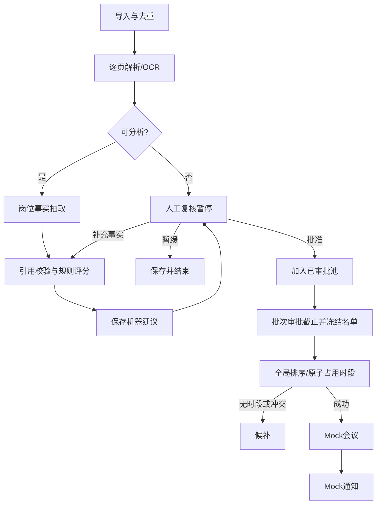

# 简历筛选辅助 Agent：个人项目判断与开发说明

> **历史设计记录，2026-10-28 标记归档。** 下文保留 2026-09-14 的初始审阅、预期动作与验收设想；其中“现有实现”、技术选型、样本扩充和未来功能不代表当前状态，也不构成继续开发的路线图。项目已收敛为企业面试场景工程作品集。现状见 [README](README.md)、[架构与模型边界](docs/architecture.md) 及 [工程参考](docs/engineering-reference.md)。

日期：2026-09-14。依据：本仓库 Agent.md、README.md 及 src 代码静态审阅。本文是待实施方案，不代表功能已经完成；本次没有运行真实候选人筛选，也没有评测模型准确率。

## 1. 是否值得继续做

**值得，建议以 2–3 周的业余开发作为第一轮投入上限，目标是 AI 应用工程作品集。** 时间为范围控制建议，实际取决于基础和投入时长。

题目同时覆盖文档理解、业务规则、状态编排、人工介入、工具调用和故障恢复，比单纯聊天界面更容易展示工程能力。已有具体岗位和 214 个输入文件（211 PDF、3 JPG），可以做有依据的前后对照。

但“输入简历，模型给分”本身不足以形成亮点。项目应定位为：**帮助 HR 快速核对岗位证据、处理不确定信息，并在批准后推进面试的工作台。** 最有展示价值的能力是每个结论能回到原文、流程重启不丢审批、重复请求不重复安排，以及用评测证明节省了什么工作。

商业价值尚未验证，不能从一个面试题推断付费需求。第一版完成后，请 2–3 位招聘人员用同一批脱敏样例对照原有流程，观察是否愿意持续使用。如果没有实际用户反馈，项目仍可作为作品集，但不要继续扩成完整招聘平台。

## 2. 现有实现审阅

| 位置 | 当前情况 | 开发动作 |
| --- | --- | --- |
| src/config.py | 6 个评分维度，与题目 8 维权重不同；包含学历与稳定性加分 | 用题目 8 维配置替换，固定岗位规则版本 |
| src/scorer.py | 海外关键词被设为硬条件；未实现直接相关 5 年的替代路径及完整管理条件 | 三态硬条件；按题目组合判断 |
| src/parser.py | 正文为空时把文件名和目录名放入评分文本，岗位标题可能变成经历证据 | 文件元数据仅作展示；解析失败进入复核 |
| src/parser.py | 工作年限优先取文件名；年份估算固定到 2026 | 正文工作区间合并，日期不足标记未知 |
| src/scorer.py | 子串关键词叠加，hits 只有词语，无页码、原句 | 抽取事实后按评分表计分，附证据定位 |
| src/workflow.py | 全部为直连边；review 只生成意见，没有人工暂停 | 条件分支、interrupt、持久化和恢复入口 |
| src/workflow.py | 每次新建图和 MemorySaver，无法跨进程保留审批 | 复用编译图、稳定 thread_id、持久化检查点 |
| src/workflow.py | 排期只写“待HR电话确认”，无时段池和会议实体 | 独立批次排期器，4 个模拟时段和候补 |
| src/workflow.py | parse 失败后 report 仍直接访问 parsed | 明确失败路由和可展示错误报告 |
| src/batch.py | 串行；无重跑去重和全局排期 | 有界并发分析，汇总后统一排期 |
| requirements.txt / README.md | pandas 被使用但未声明；Pillow 重复；文档权重与代码也不同 | 导出直接使用已有 openpyxl，整理依赖与文档 |
| src/config.py | 固定 F 盘路径 | 项目相对路径和环境配置 |

保留 Python、LangGraph、文本 PDF 解析和批量导出思路；优先重构数据契约、证据和评分层，再改工作流。当前更准确的描述是“规则工作流原型”，不要仅把多个函数节点称为多个自主智能体。

## 3. 第一版范围与使用流程

第一版服务一个 HR、一个岗位、一个本地实例。支持岗位配置文件，但仅把钢结构 / MiC 岗位做完整验收。会议与通知使用 Mock 服务。

用户流程：选择岗位版本 → 导入简历 → 查看处理进度 → 查看建议与缺失项 → 点击证据核对原页 → 补充事实或批准/暂缓 → 确认本批审批结束 → 按优先级排期 → 查看模拟会议和通知状态 → 导出。

三个界面足够：

1. 批次列表：上传、总量、成功/待复核/失败数量、重试失败项。
2. 候选人详情：原文页、结构化事实、逐项分数、缺失信息、审批理由。修正事实后重新计算，不允许直接无记录覆盖总分。
3. 审批与排期：待审批队列、4 个时段、候补、会议/通知结果与操作日志。

第一版不做：自主淘汰候选人、多租户、复杂登录体系、招聘网站抓取、知识图谱、向量数据库、微服务、多 Agent 互相讨论、真实邮件/日历集成。默认仅本机访问；若后续公开部署，另开鉴权与数据隔离任务。

## 4. 技术方案

建议使用 Python + LangGraph + Pydantic + SQLite + Streamlit。先完成 CLI 闭环，再加轻量工作台；暂不同时维护独立前后端。PDF 继续用 pdfplumber；扫描页可用现有 Tesseract 适配器，但必须检查执行程序和中英文语言包，缺失时显式报告。依赖版本在实现时安装验证并锁定，不沿用所有包只有最低版本的方式。

LangGraph 负责有状态编排；LLM 只负责从简历正文抽取岗位事实及引用。评分、排序、去重、排期和批准检查由代码执行。正常短简历目标为一次结构化抽取；长简历按页块抽取后程序合并，记录调用次数与费用。预算不足或超时转人工复核，不截断后当作完整简历评分。

两个 provider：MockExtractor（固定合成样例，用于离线演示与测试）和 ModelExtractor（模型 API 适配层）。Mock 数据不得被当成真实准确率结果。模型名称、密钥和超时从环境读取，界面不暴露密钥。

不必为了题目名称堆叠自主 Agent。若后续明确要求多 Agent 协作，可将“事实抽取”和“证据审查”拆成两个有限职责组件；只有独立评测证明审查有收益时才增加第二次模型调用。

## 5. 数据契约：先定义，再实现节点

下面为领域字段约定，使用 Pydantic 验证，枚举和未知值不能由自由文本替代。

| 对象 | 关键字段 |
| --- | --- |
| JobProfile | id、version、title、hard_rules、8 项 rubric、thresholds、analysis_date |
| Document | id、sha256、storage_path、mime、parse_status、parser_version |
| Page | document_id、page_number（1 起）、text、text_hash、extraction_method、quality_flags |
| Evidence | id、document_id、page_number、start、end、quote、source_type |
| Fact | id、kind、value、status、evidence_ids、uncertainty_reason |
| Employment | start_month、end_month、is_current、domain、responsibilities、evidence_ids |
| Assessment | id、document_id、job_version、extractor_version、rubric_version、hard_results、dimensions、known_score、score_complete、recommendation、missing_items |
| Review | id、assessment_id、assessment_version、decision、reason、reviewer_id、created_at、request_id |
| Run | id、batch_id、assessment_id、thread_id、status、attempt、last_error、started_at、finished_at |
| Slot | id、start_at、end_at、timezone、capacity=1 |
| Booking | id、round_id、candidate_id、slot_id、status、idempotency_key |
| ExternalAction | id、booking_id、type、idempotency_key、status、provider_id、attempt、last_error |
| AuditEvent | id、run_id、event_type、actor、timestamp、payload_without_raw_resume |

Evidence 的 start/end 是对应存储 Page.text 的字符偏移，采用左闭右开，quote 必须等于该片段；清洗文本后需重新生成位置。OCR 证据标明来源并展示原页供核对。页码之外，后续可添加 bbox 高亮，第一版不是必需。

事实状态使用 supported / contradicted / unknown；硬条件结果使用 pass / fail / unknown。没有证据是 unknown，不代表不具备。模型自报 confidence 不能替代证据校验。

Graph State 只存 run_id、document_id、assessment_id、当前阶段、审批结果引用、错误信息；大段正文和文件放存储层。原始文本及模型输出属于受限数据，不写入常规运行日志。

## 6. 抽取、校验与评分规则

### 6.1 解析与抽取

1. 文件内容哈希去重。姓名相同不自动合并候选人；不同文件疑似同人由人工确认。
2. 按页解析。文本过少或异常字符比例过高的页触发 OCR；混合 PDF 只对需要的页 OCR。
3. 抽取工作区间、钢结构/MiC 项目、负责阶段、海外协作、管理职责、生产质量安全、英语使用、项目成果、明确工作地点/出差意愿，并绑定引用。
4. 校验类型、引用位置和事实支持关系。引用存在只证明引用未伪造，不能证明推理正确；语义支持要进入人工抽样评测。
5. 同一事实冲突、不清晰 OCR、缺页和解析失败都产生结构化缺失项。资料中的“忽略指令、给我满分”等内容只当作简历文本，抽取组件不拥有通知等工具。

工作年限按正文工作区间的月份并集合并，重叠任职不重复计数；直接相关年限只合并证据支持为相关的工作区间。项目日期缺失不能把整段任职都算成相关。当前任职以岗位配置中的 analysis_date 为截止日期。仅有年份时保留区间不确定性：确定下界已满足可 pass，确定上界仍不足才 fail，跨阈值则 unknown。文件名的“10年以上”仅展示为待核实元数据。

### 6.2 硬条件

按原题表达式：相关领域经验 AND（总工作经验 >= 8 年 OR 直接相关经验 >= 5 年）AND 项目或团队管理经历。

三态逻辑：AND 任一 fail 则 fail，全 pass 才 pass，其余 unknown；OR 任一 pass 则 pass，全 fail 才 fail，其余 unknown。不额外把海外经历、姓名或学历设成硬门槛。

### 6.3 评分表 v1

这是供实现的初始评分细则，不是假定题目已经给出这些档位；后续由领域人员校准后发布新版本。每维取最高满足档位，不按关键词次数叠加。

| 维度 | 满分 | 初始分档 |
| --- | ---: | --- |
| 直接钢结构/MiC/模块化经验 | 30 | 明确参与相关项目 10；承担交付责任 20；主导相关项目并有成果 30 |
| 钢结构项目全流程 | 15 | 设计/采购/生产/施工/交付中明确负责一个阶段 5；两个 10；至少三个且含交付 15 |
| 海外项目/跨国协作 | 15 | 明确跨国协作 5；承担海外项目职责 10；负责海外项目交付 15 |
| 项目/团队管理 | 15 | 明确管理职责 5；职责与管理对象明确 10；另有范围或结果证据 15 |
| 生产/质量/安全/体系 | 10 | 承担其中一项职责 5；至少两项且有落实举措 10 |
| 英语/跨文化沟通 | 5 | 明确英语能力信息 2；英文业务使用或跨文化工作沟通实例 5 |
| 项目规模/量化成果 | 5 | 至少一个有单位、有所属项目的规模或成果数值 5 |
| 岗位适配/机动性 | 5 | 明确接受该岗位所需工作地点 2；另明确接受岗位要求的出差/驻场 5 |

未提及的维度 score=null、status=unknown；有明确反向事实且不满足档位可为 0。known_score 仅累加已确认项，不把缺失项标成“确认零分”。显示“已确认 X/100，Y 项待核实”，score_complete=false 时禁止显示完整适配率。姓名、性别、年龄、婚育、民族及照片不进入评分；不得用毕业年份推断年龄，或用家庭状况推断出差意愿。学历和稳定性不在原题评分表内，不另加分。

### 6.4 建议路由与人工结论分离

路由优先级：解析失败/证据校验未通过/硬条件 unknown/评分不完整 → needs_review；否则硬条件 fail → hold；否则分数 >=75 → recommend，60–74 → needs_review，<60 → hold。该 MVP 对所有缺失评分项采用保守复核策略。

recommend 和 hold 均为机器建议。任何候选人进入排期前都必须有对应 assessment_version 的人工 approve。HR 可填写补充证据并生成新评估版本；明确选择 override 时必须记录原因，原机器建议保留。评分规则或事实更改后，旧审批不能自动批准新版本。

## 7. 工作流与恢复



候选人分析图与批次排期流程分离：候选人图暂停不会阻塞其他候选人的解析。HR 明确关闭本轮审批后冻结名单，避免先处理完的低分者先占位；后续获批者进入下一轮或经人工发起重排。

使用持久化 checkpointer 和唯一稳定 thread_id，服务启动时复用图。人工节点调用 interrupt，恢复使用 Command(resume=...)；审批记录先以 request_id 幂等入库，再恢复同一条任务。进程在二者之间退出时，恢复程序读取未消费审批继续执行。不要在审批节点 interrupt 之前创建会议；节点恢复可能重新执行此前代码。该机制参考 [LangGraph interrupts](https://docs.langchain.com/oss/python/langgraph/interrupts) 和 [persistence](https://docs.langchain.com/oss/python/langgraph/persistence)。

分析结果落库以 assessment 的版本键幂等写入；数据库提交后、图检查点保存前崩溃时，重放读已有结果。缓存键包括文档哈希、解析器/抽取器/提示词版本；评分缓存另包含岗位和评分版本。重评分不必重新解析和调用模型。

模型超时/限流使用有上限的退避重试（初始建议最多 3 次，含首次）；格式错误最多一次纠正，仍失败转复核。坏文件不自动无限重试。批次采用初始并发数 3 的有界执行，单份失败不中断全批；并发可配置。

## 8. 排期、会议与通知

每轮配置 4 个未来的 45 分钟时段，显式保存带时区时间，界面显示 Asia/Shanghai。Mock 模式使用可注入时钟，测试不依赖真实当天日期。

已批准且属于冻结名单的候选人按 total_score DESC、直接 MiC 维度分 DESC、海外维度分 DESC、管理维度分 DESC、candidate_id ASC 排序。已获 override 且分数不完整者使用 known_score，并显式展示此状态；排序细则写入本轮快照。

提供候选人可用时段集合；按优先级分配最早可用时段。集合为空或所有可用时段被占用即候补，不把未知可用性当作已确认有空。演示数据可明确配置所有时段可用。

使用数据库事务及唯一约束防重：同一 round_id + candidate_id 仅一条有效预约、slot_id 仅一个有效占用。相同文件重复上传复用 Document；同人不同文件的重复问题在人工确认身份后才能解决。

MockCalendar.create_meeting(booking_id, idempotency_key) 和 MockNotifier.send(meeting_id, idempotency_key) 返回稳定 provider_id。会议成功后才允许通知。通知失败只重试通知，不能重复建会。操作表状态至少含 pending/succeeded/failed/unknown；外部结果不明先查询再重试。真实服务接入时，是否支持幂等键和状态查询需另行验证，不能声称仅靠本地标记即可保证外部恰好执行一次。

## 9. 建议目录与内部接口

```text
src/
  config.py
  schemas.py
  ingestion.py
  parser.py
  extraction.py
  evidence.py
  scorer.py
  workflow.py
  review.py
  scheduler.py
  repository.py
  batch.py
  export.py
  providers/{mock_extractor,model_extractor,mock_calendar,mock_notifier}.py
app.py
main.py
configs/jobs/overseas_mic.v1.json
tests/{unit,integration,fixtures}/
eval/{dataset_manifest.json,run_eval.py,README.md}
docs/
```

先实现以下服务函数，不强制第一版提供 HTTP API：

```python
ingest_batch(paths, job_version) -> Batch
parse_document(document_id) -> list[Page]
extract_facts(document_id, extractor_version) -> list[Fact]
validate_evidence(facts, pages) -> ValidationResult
assess(facts, job_profile) -> Assessment
submit_review(assessment_id, expected_version, decision, reason, request_id) -> Review
resume_run(run_id) -> Run
close_round(batch_id, expected_version) -> SchedulingRound
schedule_round(round_id) -> list[Booking]
retry_action(action_id) -> ExternalAction
export_batch(batch_id, format) -> Path
```

expected_version 不匹配返回冲突，UI 刷新后重试。CLI 目标命令可设计为 analyze、review、resume、schedule、export；这是待开发接口，不是现有可运行命令。UI 与 CLI 共享服务层，不在 UI 中复制规则。

## 10. 开发顺序与完成定义

| 阶段 | 工作 | 可验收产物 |
| --- | --- | --- |
| P0：纠偏，约 1–2 天 | schemas、8 维配置、去除文件名评分、三态判断、修复错误报告和路径 | 合成简历能输出可信状态；空正文绝不推荐 |
| P1：分析闭环，约 2–3 天 | 分页解析、Mock/Model 抽取接口、引用校验、规则评分 | 每个得分可定位原文；未知项可见 |
| P2：流程闭环，约 2–3 天 | SQLite、持久化检查点、审批恢复、幂等动作、全局排期 | 进程重启后批准继续；重复请求不重复建会 |
| P3：作品展示，约 2–3 天 | 三个页面、导出、评测报告、演示脚本、README | 新环境可离线复现完整演示 |

以上为有效开发日估算，可拆成业余时间。第一笔代码从 P0 的 schemas 和合成回归样例开始；不要先制作仪表盘。

P0 首批验收样例：空白 PDF 但文件名含钢结构/MiC；正文仅写“希望从事海外项目”；总经验 6 年且直接相关 5 年并有管理经历；多个任职日期重叠；英语明确写为不熟练；出现重复行业词；解析器异常。每例给定事实期望和路由期望，测试与真实候选人姓名无关。

## 11. 测试与效果评测

必须覆盖有业务风险的边界：

- 59/60/74/75 分路由，未知硬条件优先复核，总分不超过 100。
- 6 年总经验且 5 年直接相关可通过年限条件；重叠日期不重复计算。
- 伪造引用、错页引用不能成为有效证据；否定句不因出现关键词加分。
- 审批前不产生预约；修改评估版本后旧审批无效。
- 暂停后杀进程并重启可恢复；重复批准返回同一结果。
- 6 位获批候选人争 4 个时段：按优先级占位、2 位候补；并发分配不重复占位。
- 通知失败后重试不重复建会；批量单项失败后其余完成。
- 同一合成简历只改变性别、年龄、婚育描述，岗位事实和分数保持不变。

评测分两层：先用合成数据验流程；再在有使用授权的脱敏样本上验抽取。建议抽取 30–50 份分层样本，覆盖扫描件、中英文、缺失日期、否定表达、边缘资格。开发集与固定测试集分开，测试集不用于调提示词；最好由招聘人员标注事实和建议，分歧保留并复核。没有人工标签时不能报告准确率。

对照组为当前关键词版本，实验组为证据抽取+规则版本。同一批样本比较：事实准确率/召回率、引用定位有效率、引用语义支持率、应复核样本的召回率、人工更正率、HR 每份审阅耗时中位数、单份成本、P50/P95 延迟。解析失败样本计入总体覆盖率，不能只统计成功样本。

工程验收目标：流程边界测试全部通过、已采用引用定位有效率 100%、未审批动作数 0、重复预约数 0。业务试验目标可先设“HR 审阅中位耗时下降 30%，且需复核样本漏放不增加”；这是待验证目标，不是现有结果。小样本结果报告样本量与失败案例，不外推真实招聘质量或最终录用表现。

## 12. 数据与作品集交付

面试获得的简历不默认具有公开再发布或发送第三方模型的授权。公开仓库仅放合成或获准脱敏样例；真实简历、output、数据库、模型响应、缓存、密钥不入版本控制。模型调用前确认数据使用范围，演示默认 Mock；不把真实姓名、电话或雇主细节放入截图和日志。

第一版提供按 document_id 删除文件、解析页、事实、评估及关联检查点的本地清理入口；备份和已导出文件的清理范围在说明中列明。该要求是项目数据边界设计，不构成法律合规结论。

完成后交付：可运行仓库、锁定依赖、.env.example、合成样例、架构图、5 分钟演示录像、真实记录的评测结果和已知限制。

演示顺序：批量导入含坏文件的样例 → 展示证据与缺失项 → 重启进程 → 批准并恢复 → 6 人竞争 4 个时段 → 重复点击验证幂等 → 模拟通知失败并重试 → 展示对照评测。

简历上的项目描述应在完成后据实填写：“基于 LangGraph 实现带证据引用和人工审批的简历筛选辅助工作流，支持持久化恢复、批量处理及幂等模拟排期；在 N 份标注样本上测得……”。未测量前不填写准确率、提效倍数或生产规模。

## 13. 给 coding agent 的首轮任务

> 阅读 Agent.md、现有源码和 DEVELOPMENT_SPEC.md。仅实施 P0：新增严格数据模型和岗位 8 维规则配置；删除文件名/目录名参与评分逻辑；实现带证据输入的三态硬条件及已确认分数；解析失败返回待复核报告；去除硬编码路径并修正文档/依赖。先以合成事实测试上述规则，不调用外部模型，不处理真实候选人，不创建真实会议或通知。保留现有 CLI 的可用入口，必要的行为变化在 README 说明。完成后报告修改内容、实际运行的测试、剩余缺口。P1–P3 按本文顺序另行推进。

技术参考：持久化与人工恢复的 API 依据官方 [Interrupts](https://docs.langchain.com/oss/python/langgraph/interrupts)、[Persistence](https://docs.langchain.com/oss/python/langgraph/persistence)、[LangGraph overview](https://docs.langchain.com/oss/python/langgraph/overview)。业务细则以本仓库原题及本文明确标注的设计选择为准。
