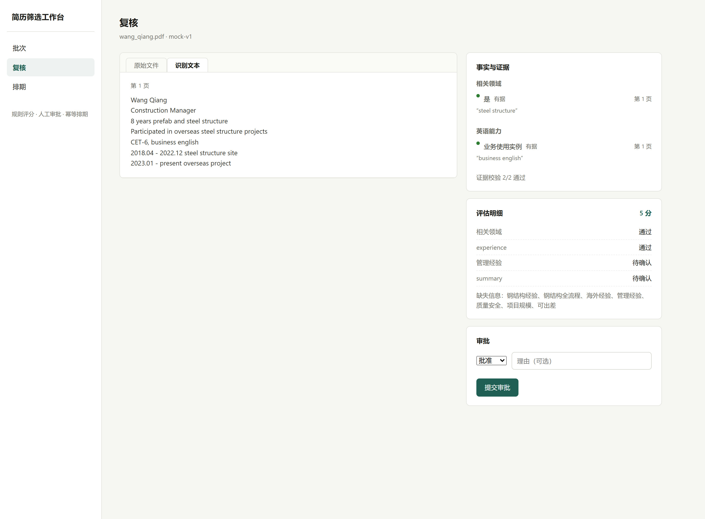
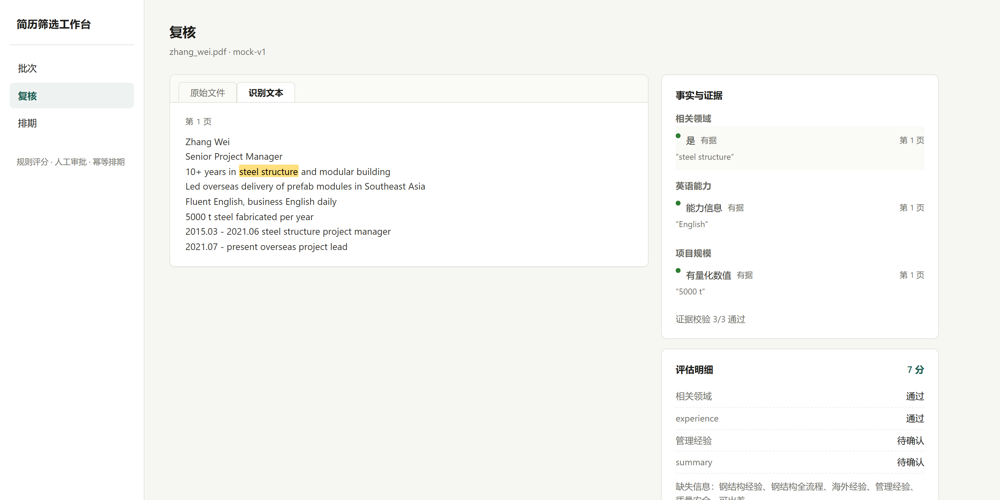

# 简历筛选 Agent（海外项目负责人 · 钢结构/MiC）

[](https://github.com/Yuan1433223/ResumeScreening/actions/workflows/ci.yml)
[](#测试)

基于 **LangGraph** 的简历筛选辅助工作流：解析 → 事实抽取（规则 / 云端大模型）→
证据校验 → 8 维岗位评分 → **人工审批（interrupt / 进程恢复）** → 幂等排期建会通知，
并配有一个 **FastAPI + React/TypeScript 的可交互工作台** 与 **真实简历评测骨架**。

工作台已内置：**登录认证开关**（默认关）、**PII 字段级加密与保留期清理**、
**Dashboard 看板**（KPI/评分分布/漏斗）、**Trace 追踪页**、**SSE 实时进度**、
**DOCX 上传 + MIME 魔数校验 + 20MB 上限**、以及 **prompt-injection 越权防护**。

面向"海外项目负责人（钢结构/MiC 方向）"岗位；`DEVELOPMENT_SPEC.md` 定义了 P0–P3
阶段规格，本仓库在其上增量完成 T1–T15（见下）。

---

## 能力亮点（技术视角）

| 能力 | 落点 | 佐证 |
| --- | --- | --- |
| 人工介入的 Agent 工作流 | review 节点 `interrupt` 等待审批；审批以 request_id 幂等入库后恢复 | `src/workflow.py`、`src/review.py` |
| 崩溃恢复与重放 | LangGraph `SqliteSaver` 检查点；恢复成功后才消费审批（T1 故障注入测试） | `tests/test_t1_recovery_boundary.py` |
| 任务身份三分离 | 文档身份 / 评估版本键 / 执行线程身份分离，跨批次稳定、换抽取器可重跑（T2） | `tests/test_t2_identity.py` |
| 云端大模型抽取 | OpenAI 兼容客户端 + 结构化输出 + 页码/原文引用定位（程序算偏移）+ 限流重试 + 成本统计（T3） | `src/providers/model_extractor.py` |
| 真实简历评测 | 标注样本对照 mock/model 的事实准确率、证据支持率、成本与延迟（T4） | `eval/run_eval.py` |
| 可交互工作台 | FastAPI 后台任务化批次 + React/TS 六页（批次/复核/排期/Dashboard/Trace/登录） | `app/api.py`、`frontend/` |
| 并发与缓存工程 | Repository 连接级 RLock、图执行锁、页面缓存复用（重跑跳过 250s OCR） | `src/repository.py`、`src/workflow.py` |
| 可观测性 | 每份简历 trace 落盘：模型调用统计（token/耗时/费用）+ 校验失败点 + 审批（T6） | `src/observability.py`、`GET /api/traces` |
| MCP 服务 | tools/resources/prompts 三要素，薄代理复用工作台 API，可被外部 Agent 编排（T7） | `mcp_server.py` |
| 认证开关 | `AUTH_ENABLED` 默认关；开启后签名 Cookie 会话 + pbkdf2 恒定时间比对，登录/登出/me 三端点（T15） | `src/auth.py`、`app/api.py` |
| PII 四件套 | documents.pii_* 字段 Fernet 加密、上传手机号/邮箱打码提示、保留期 `purge` 清理、导出 `--redact` 脱敏（T14） | `src/pii.py`、`src/config.py` |
| Dashboard 看板 | KPI / 评分分布 / 6 段漏斗，只读聚合下沉 repository（T13） | `GET /api/dashboard` |
| Trace 追踪页 | 最近 trace 可按 batch_id / document_id 过滤，前端直查（T6） | `GET /api/traces`、`frontend/src/pages/TracePage.tsx` |
| SSE 实时进度 | `event: connected/progress/done/error` + 15s 心跳；前端 EventSource + 轮询兜底（T10） | `GET /api/batches/tasks/{id}/events` |
| 上传加固 | 后缀白名单 + MIME 魔数（含 DOCX zip 容器校验）+ 20MB 上限 + PII 粗扫提示（T12/T13） | `POST /api/upload` |
| 注入防护 | 引文↔档位领域词表一致性校验 + 任职年限必须可在引文切片定位，越权特征降级 unknown 转人工（T11） | `src/providers/model_extractor.py` |
| 多租户预留 | documents/assessments/runs/batches 四表已加 `org_id` 列（默认 `local`），P2 租户隔离不改表结构 | `src/repository.py` |

**测试：175 项全部通过**（规则回归 + 恢复边界 + 模型抽取器 + 评测 runner + API +
可观测性 + 任务落库/SSE + 注入防护 + DOCX + 上传加固/Dashboard + PII + 认证，均不依赖真实网络）。

---

## 快速开始（工作台）

**方式一：docker compose 一条命令（推荐，全栈）**

```powershell
docker compose up -d --build
# 浏览器打开 http://localhost:8080 （前端 nginx 已把 /api 反代到后端 8017）
```

首次启动前可把简历 PDF/JPG/DOCX 放到宿主机 `./resumes/`（容器内挂载为 `RESUME_DIR`）。

**方式二：开发模式（双终端，前后端热更新）**

```powershell
# 终端 1：后端（FastAPI，端口 8017）
.\.venv\Scripts\python.exe -m uvicorn app.api:app --port 8017

# 终端 2：前端（Vite dev，端口 5173，/api 代理到 8017）
cd frontend; npm install; npm run dev
```

浏览器打开 **http://localhost:5173**：批次页选抽取器（规则 / 大模型）创建批次 →
复核页左原文右事实、点击证据高亮定位、提交审批 → 排期页生成预约与通知。

> 模型抽取需在 `.env` 配置 `MODEL_ENABLED=1 / MODEL_API_KEY / MODEL_BASE_URL / MODEL_NAME`
> （模板见 `.env.example`；`.env` 不入版本控制）。未配置时自动降级为人工复核，不影响其他功能。
> 开启认证需 `AUTH_ENABLED=1` 并配 `AUTH_USERNAME / AUTH_PASSWORD`；不开启则业务路由不拦截。

---

## 界面演示

> ⚠️ 截图/视频由维护者补充。以下为占位示例，请按实际截图替换路径与说明文字。

约定：截图放 `docs/screenshots/`，视频/GIF 放 `docs/video/demo.gif`。
仓库已自带 5 张可复用截图（`01-batches.png` … `05-scheduling.png`），可直接引用或增补。

```markdown






```

> 维护者注意：`06-dashboard.png`、`07-trace.png`、`demo.gif` 尚不存在，
> 录制后放入对应目录即可上图生效；不入库的素材请加进 `.gitignore`。

---

## 功能总览

- **CLI 闭环**：`analyze / batch / review / resume / schedule / export / clean`，合成数据离线可复现
- **工作台**：批次（上传/后台任务/进度轮询）、复核（原文↔事实双向定位、审批）、排期（幂等生成）
- **评测**：`eval/run_eval.py` 在真实简历上对照 mock 与 model 抽取（详见"评测"节）
- **一键演示**：`demo/run_demo.py` 跑通导入→审批→重启恢复→排期→通知重试全流程（合成数据）

## 系统架构

```mermaid
flowchart LR
    F[简历文件<br/>PDF / JPG] --> P[parse 分页解析<br/>pdfplumber / tesseract / rapidocr]
    P -->|pages 缓存<br/>重跑免 OCR| DB2[(pages 表)]

    subgraph 候选人工作流（LangGraph，每简历独立 thread）
        P --> E[extract 事实抽取<br/>mock 规则 / model 云端大模型]
        E --> V[validate 证据校验<br/>引用=原文切片]
        V --> S[screen 三态硬条件]
        S --> SC[score 8 维评分<br/>幂等落库]
        SC --> R[review interrupt<br/>人工审批]
        R --> A[apply 消费审批]
        A --> RP[report 汇总]
        P -.解析失败.-> R
        V -.校验失败.-> R
    end

    R -->|批次审批截止| B[create_round 建轮]
    B --> C[close_round 冻结]
    C --> SD[schedule_round<br/>排序+原子占槽]
    SD --> X[run_external<br/>建会→通知]
    X -.通知失败→只重试通知.-> X

    subgraph 存储（SQLite WAL）
        DB[(resume.db<br/>业务数据)]
        CK[(checkpoints.db<br/>LangGraph 检查点)]
    end
    SC --> DB
    SD --> DB
    X --> DB
    A -.进程崩溃→新进程 resume_run 恢复.-> CK
```

工作台侧：`app/api.py` 以 SQLite 为唯一事实来源；批次在**后台线程**执行
（任务表 + `GET /api/batches/tasks/{id}` 轮询），前端 React/TS 通过 `/api` 代理访问。

## 工作流节点

1. **parse** — 分页解析 PDF/图片；失败 → `needs_review`，绝不进入评分；正文落 `pages` 缓存
2. **extract** — 事实抽取：默认 Mock 规则；启用 MODEL_* 后走模型（模型只回页码+原文引用，
   程序计算偏移）；均绑定精确引用（quote=原文切片）
3. **validate** — 证据校验：引用与原文一致、页码存在、范围合法；失败 → `needs_review`
4. **screen** — 三态硬条件：相关领域经验 AND（总经验≥8年 OR 直接相关≥5年）AND 项目管理经历
5. **score** — 8 维评分（每维取最高档），输出 known_score / missing_items / 得分证据定位；幂等落库
6. **review** — interrupt 等待人工审批；审批先以 request_id 幂等入库再恢复任务
7. **apply** — 消费审批结果，仅更新审批状态（排期由独立 scheduler 完成）
8. **report** — 汇总报告（评分明细、证据原文、审批状态）

路由：解析失败/校验未通过/硬条件 unknown/评分不完整 → `needs_review`；
硬条件 fail → `hold`；≥75 → `recommend`，60–74 → `needs_review`，<60 → `hold`。

## 评分维度（8 维，满分 100）

| 维度 | 满分 | 分档 |
| --- | ---: | --- |
| 直接钢结构/MiC/模块化经验 | 30 | 参与 10 / 承担交付责任 20 / 主导并有成果 30 |
| 钢结构项目全流程 | 15 | 1 阶段 5 / 2 阶段 10 / ≥3 且含交付 15 |
| 海外项目/跨国协作 | 15 | 跨国协作 5 / 海外项目职责 10 / 海外交付 15 |
| 项目/团队管理 | 15 | 管理职责 5 / 职责对象明确 10 / 另有范围或结果 15 |
| 生产/质量/安全/体系 | 10 | 一项 5 / 两项且有举措 10 |
| 英语/跨文化沟通 | 5 | 能力信息 2 / 业务使用实例 5 |
| 项目规模/量化成果 | 5 | 有单位有所属项目的数值 5 |
| 岗位适配/机动性 | 5 | 接受工作地点 2 / 另接受出差驻场 5 |

未提及维度 score=null、status=unknown；有明确反向事实计 0；known_score 仅累加已确认项。

---

## 模型接入（T3 + T5c）

- `ModelConfig`（`schemas.py`）：云端配置契约，密钥用 `SecretStr` 防日志泄露，由 `.env` 装配
- `ModelExtractor`：提示词 v1 + 结构化解析 + 引用定位（模型回页码+原文引用，程序算偏移；
  定位失败→明确歧义转人工）+ 有限重试（首次最多 3 次）+ 格式纠正一次 +
  token/耗时/成本统计（`ExtractionReport.stats`）
- `CloudModelClient`：OpenAI 兼容 `/chat/completions`（DeepSeek 等通用）；
  429/5xx/网络超时自动重试，4xx 不重试
- 未配置/未启用 → 空报告 + 警告 + 人工复核，不影响规则版流程
- 工作台接入：抽取器可选 mock/model；`node_extract` 由 state 驱动；批次后台任务化 +
  页面缓存复用（同文档重跑跳过 OCR，实测长图 rapidocr 约 250s/张 → 缓存命中 0s）

## 评测（T4）

- `eval/run_eval.py`：标注样本（`labels/`）+ runner（dev/test 划分、micro P/R/F1、
  转人工率、截断引用率、成本与延迟 P50/P95）；`results/` 输出脱敏聚合
- **真实简历对照**（9/18 已标注 **7 份 dev**，tag `dev7_20260918`；test 3 份保留验收）：

| 抽取器 | 样本 | P | R | F1 | 证据定位 | 截断引用 | 转人工率 | 成本/延迟 |
| --- | --- | ---: | ---: | ---: | ---: | ---: | ---: | --- |
| mock 规则 | 7 dev | 0.34 | 0.39 | **0.36** | 100% | 8.5% | 0% | 本地即时 |
| model 大模型 | 7 dev | 0.78 | 0.68 | **0.73** | 100% | 0% | 71.4% | 9 次调用/7 份，P95 67s |

- 模型相对规则：F1 0.36→0.73，引用完整（平均引文 32 字符 vs 规则 2.3 字符被截断）、
  不误报专业名；代价是 71% 样本触发"引用定位失败→转人工"警告（保守，宁可交人工不硬凑）
- **跨运行波动**（`eval/verify_consistency.py` 三层验证）：输入侧工作台 pages 缓存与
  评测重新解析**逐页一致**；规则侧 mock 输出**完全一致**；模型侧不精确复现
  （temperature=0 下仍出现 1 项事实差异，两天重跑 F1 0.67 → 0.88）。结论：评测可外推到
  工作台，但模型需固定测试集 + 记录运行日期/模型版本（T6 已落地）
- 模型错误主要是档位粒度与 GT 口径争议（如推断 relevant_domain=True 但 GT 未含→记 spurious，
  会低估模型）——口径本身是有价值的讨论点
- 数据边界：真实简历本地评测与云端调用已获确认；`labels/`、`results/` 不入版本控制

## 工作台（T5a/T5b/T5c）

- **T5a 服务层**：FastAPI（`app/api.py`）复用现有 workflow/repository，SQLite 为唯一事实来源；
  复核接口按需解析并缓存 `pages`（同一文档二次复核免重解析）
- **T5b 前端**：React 18 + TypeScript 严格模式 + Vite，无 UI 库；
  三页：**批次**（上传/创建/结果表）、**复核**（左原文右事实，点击事实高亮定位，提交审批）、
  **排期**（时段表 + 预约/通知状态）；视觉：系统字体、白/浅灰、单一墨青强调色，去 AI 味
- **T5c 后台任务 + 模型接入**：`POST /api/batches` 后台线程执行（单份失败不阻断）；
  `GET /api/batches/tasks/{id}` 轮询（done/total/current_file/rows）；
  Repository 公开方法 `threading.RLock` 统一包裹 + `_GRAPH_LOCK` 保护图执行；
  批次每次运行独立线程（`{batch_id}__{file}`），换抽取器重跑得到全新分析；
  `node_parse` 优先读 pages 缓存（有测试保证 parse_document 被禁用时重跑仍成功）
- **T5d 工作台体验**：上传逐文件反馈、批次进度常驻与刷新恢复、复核页原始文件直出
  （PDF 内嵌阅读器 / 图片直出）+ 识别文本可切换、事实按维度分组去重、枚举全部中文化
- **T5e 一致性验证**（`eval/verify_consistency.py`）：工作台批次路径 vs 评测路径
  三层对照——pages 输入逐页一致、mock 输出完全一致、model 输出有跨运行波动；
  dev 未标注样本（004–010）自动生成候选事实表（`eval/labels/candidates/`，供人工审改 GT）
- **真实冒烟**（一份 JPG，5046 字）：缓存命中后模型批次 39s 完成
  （模型调用 37.5s，9 事实 4 任职，in=3606/out=8227 token）；复核页 12 事实、证据 12/12

## 可观测性（T6）

- 批次处理每份简历落一条 trace（`data/traces/<日期>.jsonl`，线程安全、不入库）：
  批次/任务/抽取器、document_id/文件名、解析状态、事实与任职数、
  **模型调用统计**（calls/耗时/输入输出 token/费用）、**校验失败点**（引用定位失败等警告）、
  审批状态与综合评分
- `GET /api/traces?batch_id=...&limit=50` 查询最近 trace（最新在前，可按批次过滤）
- 用途：从候选人追到模型调用、失败、审批与重试；修改提示词后用同一批样本回归对比

## MCP 服务（T7）

- `mcp_server.py` 把工作台按 MCP 标准暴露（mcp 2.x，`MCPServer`）：
  - **tools（8）**：`list_resumes` / `upload_resume` / `create_batch` / `get_batch_task` /
    `get_review` / `approve` / `get_scheduling` / `run_scheduling`
  - **resources（2）**：`resumes://list`、`resumes://{document_id}/review`
  - **prompts（1）**：`review_resume`——按岗位标准评审指定简历的完整提示词
- 实现为**薄代理**：HTTP 复用本机 FastAPI（8017）为唯一事实来源——批次后台任务、
  审批、pages 缓存、trace 全部一致，MCP 层不重复业务逻辑
- 连通性已用官方客户端验证（`mcp_client_test.py`，stdio）：
  握手 → 三要素列举 → `create_batch → get_batch_task 轮询 → get_review → approve`
  全链路通过，resource 与 prompt 可读
- 运行：先起后端（8017），再 `python mcp_server.py`；外部 Agent（如豆包）可按
  stdio 传输接入，`RESUME_API_BASE` 可覆盖 API 地址

## CLI 命令

```powershell
# 单份分析（停在审批节点；--batch-id 归批、--thread-id 固定检查点线程）
python main.py analyze "海外项目负责招聘简历\xxx.pdf" --batch-id b1

# 批量分析（合成样例演示）→ 证据校验/评分/路由落库
python main.py batch --dir demo\samples

# 提交审批（approve/hold/reject；--request-id 相同则幂等；版本不匹配报 VersionConflictError）
python main.py review <assessment_id> approve --version v1 --request-id req001

# 恢复被中断任务（审批已入库但恢复前崩溃时：读取未消费审批继续执行）
python main.py resume <run_id>

# 批次排期：建轮 → 冻结 → 6 人争 4 时段 → 建会 → 通知（--fail-notify/--retry 演示幂等重试）
python main.py schedule <batch_id> --fail-notify 1 --retry

# 导出批次状态（JSON/Markdown/Excel）
python main.py export <batch_id>

# 本地清理：按 document_id 级联删除数据与检查点（规格 §12）
python main.py clean <document_id> [--delete-file]
```

一键演示：`python demo\make_samples.py demo\samples` → `python demo\run_demo.py`，
产物 `demo\output\` 下三个静态展示页 + 评测报告（离线可打开）。

---

## 代码地图 · 精简版

> 想改某块功能时，先定位这一层，再下钻。每条 = 关键文件/类 + 一句话职责 + 对外契约。

**入口**
- `main.py` — CLI 闭环（`analyze/batch/review/resume/schedule/export/clean/graph`）。
- `app/api.py` — FastAPI 工作台后端；契约：`/api/auth/*`（login/logout/me）、
  `/api/upload`、`POST /api/batches`、`GET /api/batches/tasks/{id}`、
  `GET /api/batches/tasks/{id}/events`（SSE）、`GET /api/dashboard`、`GET /api/traces`、
  `/api/documents/{id}/review|approve|file`、`/api/scheduling*`。

**工作流层**
- `src/workflow.py` — LangGraph 节点链 `parse→extract→validate→screen→score→review→apply→report`；
  `review` 用 `interrupt` 挂起，`SqliteSaver` 持久化线程。
- `src/state.py` — LangGraph 共享状态（含 `skip_parse` 测试注入开关）。
- `src/scheduler.py` — 排期器：冻结名单排序、原子占槽、外部建会/通知动作。
- `src/review.py` — 审批服务：版本校验、`request_id` 幂等、恢复未消费审批。

**数据与安全层**
- `src/repository.py` — SQLite 单点边界 + 只读聚合（KPI/分布/漏斗 SQL 在此下沉）；连接级 RLock。
- `src/task_store.py` — 批次任务落 `batch_tasks` 表，跨进程可读；同时是 SSE 的数据源。
- `src/pii.py` — PII 提取/打码 + Fernet 字段级加解密（透明加解密在 repository 层）。
- `src/auth.py` — 会话 Cookie 签名、pbkdf2 密码哈希、`get_current_user` 依赖。
- `src/config.py` — env 装配（岗位画像/评分表/路径/MODEL_*/AUTH_*/PII_*）。

**抽取与评测**
- `src/providers/` — `mock_extractor`（规则）/ `model_extractor`（云端大模型，含注入防护）
  / `mock_calendar` / `mock_notifier`。
- `src/extraction.py` — 抽取服务层入口，mock/model 分派。
- `eval/` — `run_eval.py`（runner）+ `published/`（脱敏聚合摘要，可入库对外发布）。

**前端**
- `frontend/src/pages/` — `BatchesPage` / `ReviewPage` / `SchedulingPage` /
  `DashboardPage` / `TracePage` / `LoginPage` 六页，分别对应上述 API。
- `frontend/src/api.ts`、`types.ts` — 前端 HTTP 客户端与 TS 契约。

**部署与集成**
- `mcp_server.py` — MCP 服务（tools/resources/prompts，stdio，薄代理后端 8017）。
- `Dockerfile` / `docker-compose.yml` / `frontend/Dockerfile` + `nginx.conf`
  — 后端镜像 + 前端多阶段构建（nginx 反代 `/api`）；compose v2.24+。

**精简调用链**

```
上传（后缀→魔数→20MB 校验，任一失败不落盘）
  → 创建批次（任务落 task_store，SSE 推进度）
  → parse/extract（证据 quote=原文切片，模型含注入越权校验）
  → 复核（左原文右事实 + 证据点击高亮 + 8 维雷达）
  → 审批（request_id 幂等入库后恢复图）
  → 排期（冻结→排序→原子占槽→建会→通知，失败只重试通知）
```

---

## 项目结构

```
ResumeScreening/
├── Agent.md                     # 任务说明（原题）
├── DEVELOPMENT_SPEC.md          # 开发规格与 P0-P3 完成定义
├── README.md                    # 本文件
├── requirements.txt             # 依赖（锁定版本，含 fastapi/uvicorn/httpx/cryptography）
├── .env.example                 # 环境变量模板（MODEL_*/AUTH_*/PII_*，密钥不入库）
├── Dockerfile                   # 后端镜像（python:3.12-slim，uvicorn 8017）
├── docker-compose.yml           # 全栈一键起（backend + web(nginx)，8080:80）
├── .github/workflows/ci.yml      # CI：backend pytest + frontend build
├── main.py                      # CLI 入口（analyze/batch/review/resume/schedule/export/clean/graph）
├── app/
│   └── api.py                   # FastAPI 工作台后端（auth/upload/batches/SSE/dashboard/traces/review/scheduling）
├── frontend/                    # React+TS+Vite 工作台（六页）
│   ├── Dockerfile               # 前端多阶段构建（node:22 编译 → nginx:alpine 托管）
│   ├── nginx.conf               # /api 反代到 backend:8017 + SPA 回退
│   └── src/
│       ├── pages/               # Batches/Review/Scheduling/Dashboard/Trace/Login
│       ├── api.ts / types.ts    # HTTP 客户端与 TS 契约
├── mcp_server.py                # MCP 服务（tools/resources/prompts，stdio，薄代理 8017）
├── mcp_client_test.py           # MCP 官方客户端连通性测试（全链路）
├── eval/                        # 评测：标注格式 + runner + 一致性验证
│   └── published/               # 脱敏聚合摘要（可对外发布，labels/results 不入库）
├── docs/
│   ├── screenshots/             # 界面截图（01-batches … 05-scheduling 等）
│   └── video/                   # 演示 GIF（demo.gif，维护者补充）
├── demo/
│   ├── run_demo.py              # 一键演示脚本（按规格 §12 顺序，合成数据）
│   ├── make_samples.py          # 合成样例生成器（最小 PDF + 坏文件）
│   ├── samples/                 # 生成的合成样例（可离线复现）
│   └── output/                  # 演示产物（不入版本控制）
├── src/
│   ├── config.py                # 岗位画像、8 维评分表 v1、三态硬条件、路径、env 装配
│   ├── schemas.py               # Pydantic 数据契约（含 ModelConfig / ExtractionReport）
│   ├── state.py                 # LangGraph 共享状态
│   ├── parser.py                # 分页解析（PDF / OCR / DOCX / 文件名元数据）
│   ├── extraction.py            # 抽取服务层入口（extract_facts，mock/model 分派）
│   ├── evidence.py              # 证据引用校验（validate_evidence）
│   ├── scorer.py                # 三态硬条件 + 8 维规则评分 + 建议路由
│   ├── workflow.py              # LangGraph 工作流（parse→…→score→review(interrupt)→apply→report）
│   ├── observability.py         # trace JSONL 落盘/查询（模型调用统计 + 校验失败点）
│   ├── repository.py            # SQLite 仓库（WAL、唯一约束、幂等 API、RLock、页面缓存、聚合）
│   ├── task_store.py            # 批次任务落库（batch_tasks 表）+ SSE 数据源 [T10]
│   ├── review.py                # 审批服务（版本校验、request_id 幂等、恢复任务）
│   ├── scheduler.py             # 全局排期器（冻结名单排序、原子占槽、外部动作）
│   ├── auth.py                  # 单用户认证（签名 Cookie 会话 + pbkdf2 哈希，默认关）[T15]
│   ├── pii.py                   # PII 提取/打码 + Fernet 字段级加解密 [T14]
│   ├── providers/               # mock_extractor / model_extractor / mock_calendar / mock_notifier
│   └── batch.py                 # 批量处理与导出（JSON/Excel/Markdown，--redact 脱敏）
├── tests/                       # 175 项（conftest 临时 SQLite 隔离，不依赖真实网络）
└── 海外项目负责招聘简历/          # 真实数据源（仅本地，不入版本控制）
```

## 参数键字典 · 完整版

> 与 `src/config.py` + `.env.example` 逐条对齐；`RESUME_API_BASE` 来自 `mcp_server.py`。
> 所有键均为环境变量，复制 `.env.example` 为 `.env` 后按需填写（`.env` 不入版本控制）。

| 键 | 用途 | 默认值 | 出处 | 是否必填 |
| --- | --- | --- | --- | --- |
| `RESUME_DB_PATH` | 业务 SQLite 路径 | `data/resume.db` | `src/config.py` | 否 |
| `RESUME_CHECKPOINT_PATH` | LangGraph 检查点 SQLite 路径 | `data/resume.checkpoints.db` | `src/config.py` | 否 |
| `MODEL_ENABLED` | 云端模型抽取开关（1/true/yes 开） | `0`（关，规则版） | `src/config.py` / `.env.example` | 否 |
| `MODEL_PROVIDER` | provider 名（自由文本，仅标识） | 空串 | `src/config.py` / `.env.example` | 否 |
| `MODEL_BASE_URL` | OpenAI 兼容 `/chat/completions` 地址 | 空串 | `src/config.py` / `.env.example` | 开模型时必填 |
| `MODEL_API_KEY` | 云端 API 密钥（`SecretStr` 防日志泄露） | 空串 | `src/config.py` / `.env.example` | 开模型时必填 |
| `MODEL_NAME` | 模型名（如 deepseek-chat） | 空串 | `src/config.py` / `.env.example` | 开模型时必填 |
| `MODEL_TIMEOUT_SECONDS` | 单次请求超时（秒） | `60` | `src/config.py` / `.env.example` | 否 |
| `MODEL_MAX_RETRIES` | 429/5xx 重试次数 | `2` | `src/config.py` / `.env.example` | 否 |
| `MODEL_MAX_COST_CENTS` | 单份预算上限（美分），0=不限；超限转人工 | `0` | `src/config.py` / `.env.example` | 否 |
| `MODEL_PROMPT_VERSION` | 提示词版本键 | `p1` | `src/config.py` / `.env.example` | 否 |
| `MODEL_TEMPERATURE` | 采样温度 | `0` | `src/config.py` / `.env.example` | 否 |
| `MODEL_COST_PER_1K_INPUT_CENTS` | 输入计费（美分/千 token），填了才估成本 | `0` | `src/config.py` / `.env.example` | 否 |
| `MODEL_COST_PER_1K_OUTPUT_CENTS` | 输出计费（美分/千 token） | `0` | `src/config.py` / `.env.example` | 否 |
| `PII_ENCRYPT_KEY` | Fernet 对称密钥（base64 urlsafe 32 字节）；空=明文模式+启动警告 | 空串（明文模式） | `src/config.py` | 否（生产建议填） |
| `PII_RETENTION_DAYS` | 简历保留天数，早于此由 `purge` 清理；0=不自动保留 | `90` | `src/config.py` | 否 |
| `AUTH_ENABLED` | 认证开关（1/true/yes 开） | `0`（关） | `src/config.py` / `.env.example` | 否 |
| `AUTH_USERNAME` | 登录用户名；开启认证后必填 | 空串 | `src/config.py` / `.env.example` | 开认证时必填 |
| `AUTH_PASSWORD` | 登录密码（运行时 pbkdf2 哈希比对，不落库）；开启认证后必填 | 空串 | `src/config.py` / `.env.example` | 开认证时必填 |
| `AUTH_SECRET_KEY` | 会话 Cookie 签名密钥；空则由 `AUTH_PASSWORD` 派生并告警 | 空串（派生） | `src/config.py` / `.env.example` | 否（生产建议显式填） |
| `RESUME_API_BASE` | MCP 薄代理的后端地址 | `http://127.0.0.1:8017` | `mcp_server.py` | 否 |

> 生成 Fernet 密钥：`python -c "from cryptography.fernet import Fernet; print(Fernet.generate_key().decode())"`。

## 测试

```powershell
.\.venv\Scripts\python.exe -m pytest -q   # 175 passed
```

| 批次 | 用例数 | 要点 |
| --- | ---: | --- |
| P0 规则回归 | 15 | 合成样例（空正文绝不推荐、年限并集、路由边界 59/60/74/75 等） |
| P1 抽取/校验 | 13 | 分页解析、Mock 抽取、引用校验（伪造/错页/越界拒绝）、端到端可定位 |
| P2 流程闭环 | 8 | 审批前不排期、重复批准幂等、崩溃恢复、6 争 4 排期、通知失败重试、批量容错 |
| T1 恢复边界 | 3 | 审批消费时序、END 重放保护（故障注入） |
| T2 身份三分离 | 4 | 同文件重跑复用、评估版本键、跨批次线程稳定 |
| T3 模型抽取器 | 13 | 结构化解析、引用定位、重试/纠正、成本统计（mock HTTP） |
| T3 云端客户端 | 6 | 429/5xx 重试、4xx 不重试、响应结构异常（mock HTTP） |
| T4 评测 runner | 10 | 指标计算、dev/test 划分、无标注基线、截断引用率 |
| T5 API | 22 | 批次/复核/审批、后台任务轮询、抽取器版本透出、页面缓存复用、model 未启用降级 |
| T6 可观测性 | 2 | trace 落盘/查询端点（batch_id/document_id 过滤） |
| T8 复核抽取一致性 | 4 | 复核详情透出 payload 评分字段，工作台↔评测口径一致 |
| T9 文件内联 | 2 | 原始 PDF 内联返回、缺失文件 404 |
| T10 任务落库+SSE | 7 | 批次任务落 SQLite 跨进程可读、SSE connected/progress/done/error 协议与心跳 |
| T11 注入防护 | 5 | 引文↔档位领域词表一致性、年限必须可在引文定位，越权降级 unknown |
| T12 DOCX | 3 | DOCX 解析、zip 容器魔数校验 |
| T13 上传加固+Dashboard | 11 | 后缀白名单/20MB 上限/MIME 魔数/PII 提示、Dashboard KPI/分布/漏斗聚合 |
| T14 PII | 20 | Fernet 加解密、明文模式警告、保留期 purge、导出 --redact 脱敏 |
| T15 认证 | 22 | 登录/登出/me、签名 Cookie、pbkdf2 比对、开启缺配置 fail-fast、关闭态放行 |

---

## 变更说明（历史）

- **P3**：CLI 闭环（analyze/review/resume/schedule/export/clean）、document 级级联清理、
  路径环境变量覆盖、一键演示与静态展示页、合成评测报告（不虚报准确率）
- **P2**：SQLite 持久化（WAL+唯一约束）、审批 interrupt/恢复（SqliteSaver）、
  全局幂等排期、外部动作幂等（通知失败只重试通知）、测试隔离（conftest）
- **P1**：分页解析、Mock 抽取（精确字符偏移引用）、证据校验、评分明细可回溯原文
- **P0**：8 维档位评分（每维取最高档）、三态硬条件、文件名不参与评分、
  空正文/解析失败直接人工复核

## 注意事项 / 已知边界

- OCR：优先 tesseract（系统安装时），未安装自动回退 rapidocr-onnxruntime；
  实测本机长图 rapidocr 约 250s/张（切片推理），普通图片约 30s；工作台靠 pages 缓存跳过重跑
- 批次行展示该文档**最近一次**审批结果；换抽取器重跑覆盖同文档评估，旧审批仍显示属预期
- LangGraph 检查点反序列化自定义 Pydantic 类型时打印 "Deserializing unregistered type"
  警告（默认不阻塞，未来版本可能收紧，届时需注册允许模块）
- 排期/会议/通知默认 mock 实现（`providers/`），真实集成需替换
- Mock 抽取不代表真实准确率；真实评测见"评测"节（小样本标注对照）

## 简历上的项目描述（据实填写模板）

> 基于 LangGraph 实现带证据引用和人工审批的简历筛选辅助工作流：支持持久化恢复、
> 批次处理、幂等模拟排期，并接入云端大模型抽取与真实简历评测（175 项测试全绿；
> 7 份真实简历标注对照 model F1 0.73 vs 规则 0.36，工作台/评测路径一致性已验证，
> 模型调用统计与失败点可观测、可审计）；配套 FastAPI + React/TS 可交互工作台
> （登录开关、PII 字段加密与保留期清理、Dashboard 看板、Trace 追踪、SSE 实时进度、
> DOCX 上传魔数校验、prompt-injection 越权防护），
> 并以 MCP 标准（tools/resources/prompts）对外暴露，可被外部 Agent 编排。
> 在合成样本上验证了解析容错、跨进程恢复、6 人竞争 4 时段的排期闭环与外部动作幂等。
