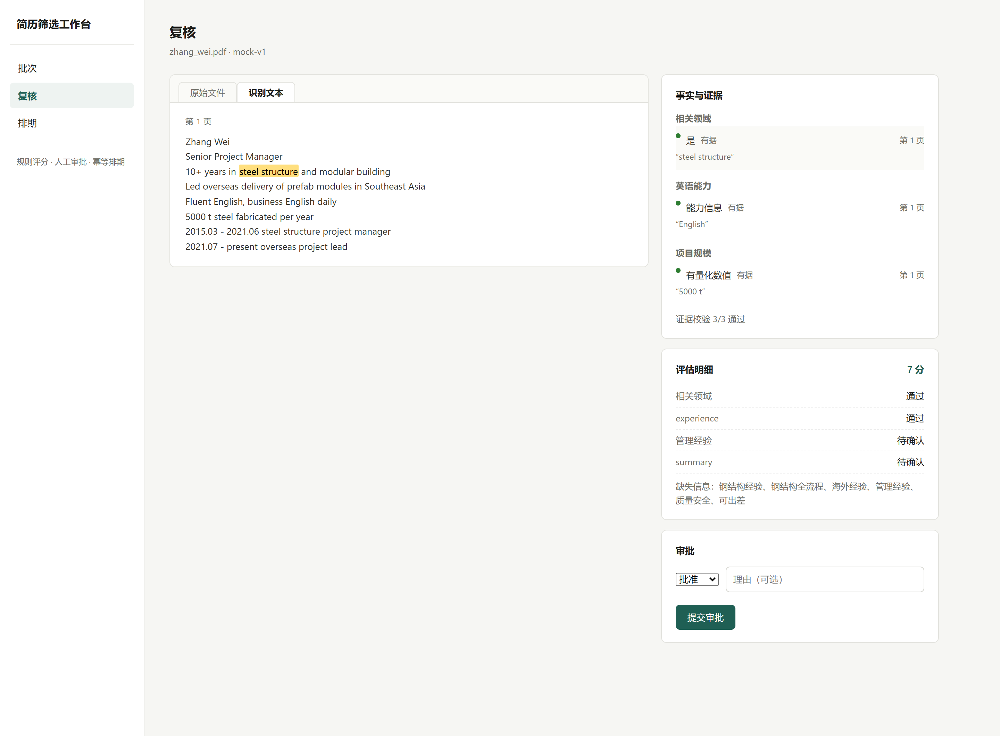
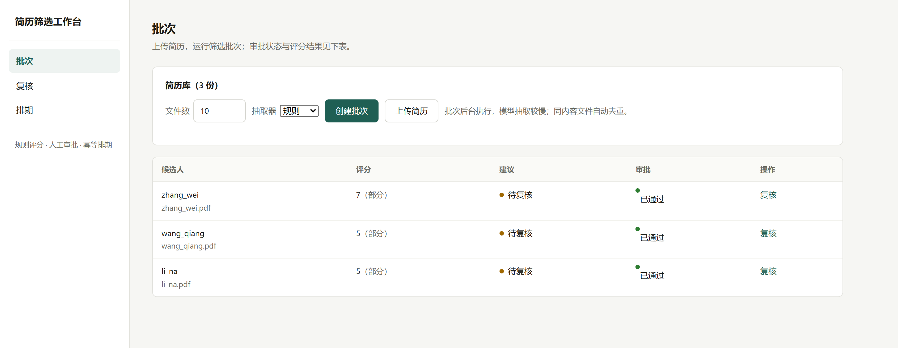
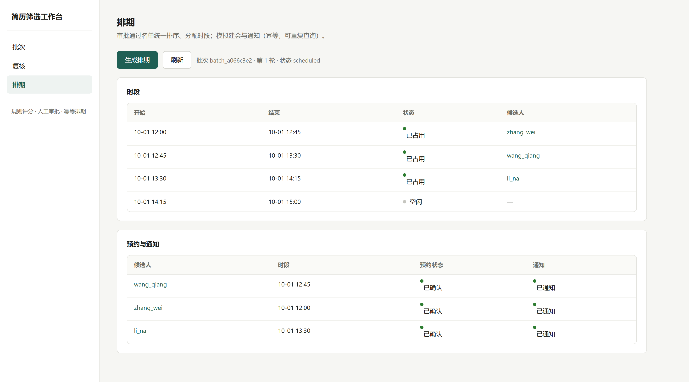

# ResumeScreening · 带证据与人工审批的简历筛选工作流

[](https://github.com/Yuan1433223/ResumeScreening/actions/workflows/ci.yml)
[](#验证与评测)
[](LICENSE)

从企业 AI Agent 面试场景延伸的工程作品集：将简历正文转为可核对的岗位事实，由程序执行评分，在人工批准后通过独立入口完成模拟排期。

**项目已按作品集范围收敛。** 保留一个具体岗位（海外项目负责人 · 钢结构 / MiC），用于说明模型抽取、规则决策、人工控制与故障恢复的职责划分。当前是单用户本地工程案例；不宣称商业需求已验证或企业生产就绪，也不以持续补齐企业系统为后续目标。

[架构与模型边界](docs/architecture.md) · [项目介绍与设计取舍](docs/case-study.md) · [工程参考](docs/engineering-reference.md) · [评测口径](eval/README.md) · [前端展示取舍](docs/frontend-options.md)

## 值得看的三个设计

| 设计 | 当前实现 | 代码与验证 |
| --- | --- | --- |
| 证据约束的模型抽取 | 模型返回事实、页码与引文；程序计算偏移并检查原文切片，缺失信息保留 unknown | `model_extractor.py`、`evidence.py`；抽取与引用回归测试 |
| 人工审批与恢复 | LangGraph interrupt 暂停；审批先持久化，恢复成功后才消费；已结束线程重放只补收尾 | `workflow.py`、`review.py`；T1 故障注入与重放测试 |
| 分离分析与排期 | 候选人图产出建议，排期器独立排序和占槽；会议与通知使用 mock，CLI 可演示失败动作重试 | `scheduler.py`、`repository.py`；P2 流程测试 |

配套 FastAPI + React/TypeScript 工作台，以及 MCP API 代理、任务进度、聚合看板、处理记录、单用户登录开关和指定 PII 字段加密。这些是工程配套；完整边界见[架构说明](docs/architecture.md#当前实现限制)。

## 架构总览


模型参与事实抽取；硬条件、八维评分和时段分配由程序执行；批准由人工完成。所有正常候选人分析最终都会暂停等待审批，机器建议不自动替代人工决定。项目没有多 Agent 讨论、开放式自主规划或模型内部思维链展示。

[查看工作流、审批时序与实现限制](docs/architecture.md) · [下载架构 PNG](docs/assets/architecture.png)

## 界面

以下为仓库已有合成样例截图，展示已实现的交互；截图早于部分看板与追踪功能，不作为当前版本所有页面的完整快照。

**复核：原文与岗位事实并列，点击事实引文在识别文本中高亮。**



**批次：选择抽取器、查看候选人结果和审批状态。**



**排期：独立生成时段与候补，展示模拟会议和通知结果。**



复核页当前会重抽取事实，不能保证其事实与原评分快照完全一致；评分项 ID 到前端的联动也存在限制。上图只说明事实引文点击交互，不表示完整证据审计链已经闭合。

## 本地运行

需要 Python 3.12、Node.js 与 npm。Windows PowerShell 示例：

```powershell
python -m venv .venv
.\.venv\Scripts\python.exe -m pip install -r requirements.txt
Copy-Item .env.example .env
cd frontend
npm ci
cd ..
```

规则模式不需要模型 API 密钥。已有环境请保留自己的 `.env`。工作台简历目录为项目根目录下的 `海外项目负责招聘简历/`；不随仓库提供真实业务数据。

```powershell
# 终端 1：后端
.\.venv\Scripts\python.exe -m uvicorn app.api:app --host 127.0.0.1 --port 8017
```

```powershell
# 终端 2：前端
cd frontend
npm run dev
```

打开 [本地工作台](http://localhost:5173)。选择规则或模型抽取 → 创建批次 → 核对事实和机器建议 → 提交人工审批 → 显式发起模拟排期。

模型模式需在 `.env` 配置 `MODEL_ENABLED=1`、`MODEL_BASE_URL`、`MODEL_API_KEY`、`MODEL_NAME`；会将分页正文发送给配置的云端服务。未启用时返回提示并保留人工处理路径。完整环境变量见[工程参考](docs/engineering-reference.md#环境变量字典)。

现有离线演示可运行 `python demo/run_demo.py`，复用仓库合成样例，在独立的 `data/demo*.db` 和 `demo/output/` 下输出结果。它验证恢复、幂等和模拟排期场景，不代表真实筛选准确率。

仓库也提供 `docker-compose.yml`，入口为 `docker compose up -d --build`、端口 8080；**配置尚未完成 Docker 构建实测**。不要将该入口理解为已验收的部署方案。

## 验证与评测

2026-10-28 本地验证：**175 项测试通过，前端生产构建通过**。测试使用隔离数据和模拟服务，不依赖真实网络。前端构建存在主包体积提示，Docker 与真实外部服务不在该结论范围。

```powershell
.\.venv\Scripts\python.exe -m pytest -q
# 在 frontend/ 下
npm run build
```

历史评测（2026-09-18，**7 份 dev 简历**）：

| 抽取器 | Precision | Recall | 事实抽取 F1 | 引用切片定位有效率 | 抽取警告触发率 |
| --- | ---: | ---: | ---: | ---: | ---: |
| 规则 | 0.34 | 0.39 | 0.36 | 100% | 0% |
| 模型 | 0.78 | 0.68 | 0.73 | 100% | 71.4% |

这是小样本历史观测，不是当前代码重新评测后的验收指标，也不是招聘决策准确率。引用可定位不代表语义判断正确；历史 JSON 中 `review_rate` 按抽取警告关键词计算，不是工作流的实际人工复核率。成本零值不能证明免费；模型延迟 P95 约 67 秒仅适用于当次样本和运行条件。历史摘要缺少完整模型运行配置，不能保证精确复现。

[聚合结果与解释](eval/published/README.md) · [评测方法](eval/README.md)

## 收尾边界

现有工程机制和验证材料保留为案例。已确认的复核重抽取、同路径文件缓存失效、历史审批跨评估影响、后台线程中断恢复等限制，集中记录在[架构说明](docs/architecture.md#当前实现限制)，避免把设计目标写成已完成能力。

登录默认关闭；PII 加密仅覆盖三个指定列，原文等仍是明文；保留期清理由命令显式执行；会议和通知均为 mock。org_id 仅是预留列。以上不作为企业安全、租户隔离或真实系统集成的承诺。

前端可以围绕现有批次页与复核页做一次有限视觉整理；完整模板迁移、聊天入口、多 Agent、真实日历和新增业务模拟不进入本轮收尾范围。依据见[前端展示取舍](docs/frontend-options.md)。

## 项目文档

- [架构与模型边界](docs/architecture.md)：当前架构、工作流、审批时序及限制。
- [项目介绍与设计取舍](docs/case-study.md)：可用于作品集和面试的简短介绍及三个设计讨论点。
- [工程参考](docs/engineering-reference.md)：代码地图、评分规则、配置、CLI 与 MCP。
- [协作手册](Agent.md)：维护项目时的操作约定。
- [开发规格（历史）](DEVELOPMENT_SPEC.md)：重构过程中的初始方案，已停止作为开发路线图。
- [架构升级探索（历史）](docs/architecture-upgrade.html)、[竞品对标（历史）](docs/competitive-benchmark.html)：保留决策背景；其中分级、数字及后续路线不代表当前状态。

许可证：[MIT](LICENSE)。
