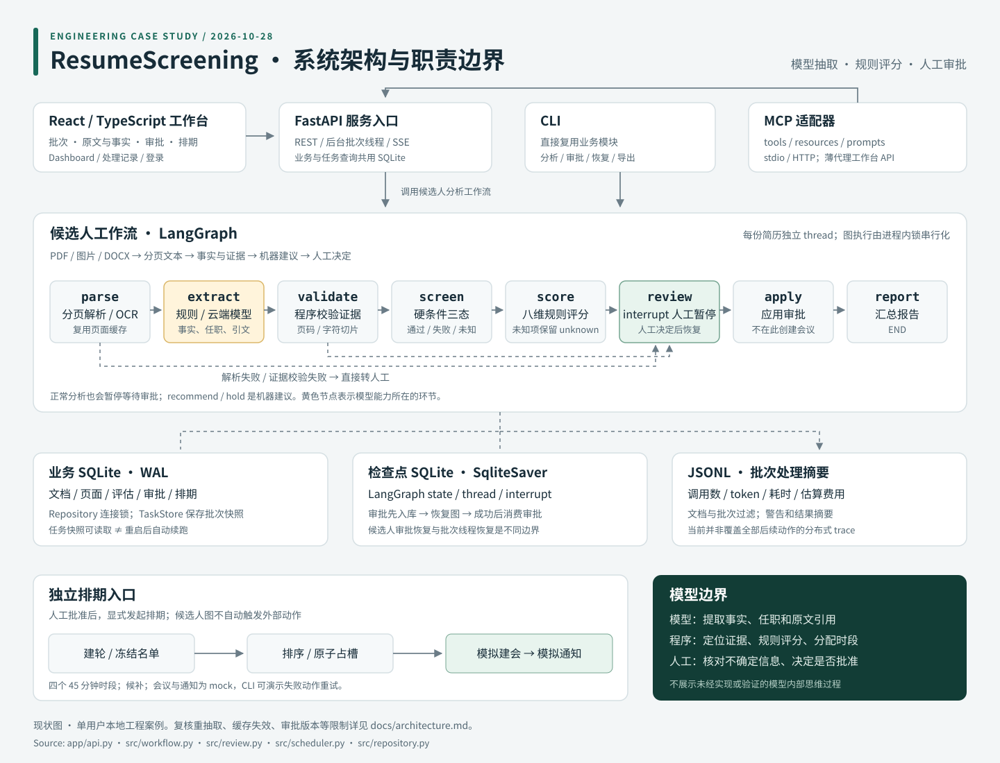
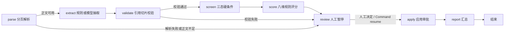
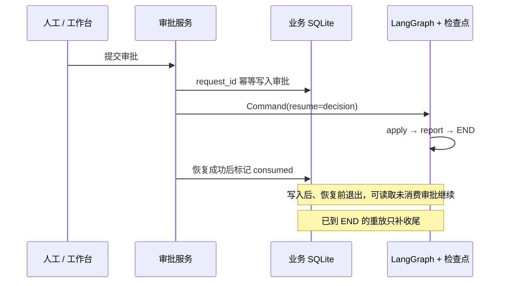

# 架构与模型边界

核对日期：2026-10-28。本文描述当前源码；项目以企业面试场景的工程作品集收尾，不将未实现能力画成现状。

## 系统组成

| 层 | 实现 | 职责 |
| --- | --- | --- |
| 工作台 | React 18 / TypeScript / Vite | 批次、证据复核、审批、模拟排期、聚合看板与处理记录 |
| 服务入口 | `app/api.py` | FastAPI REST；后台线程处理批次，SSE 推送任务进度 |
| 其他入口 | `main.py`、`mcp_server.py` | CLI 直接复用业务模块；MCP 通过 HTTP 代理工作台 API |
| 候选人分析 | `src/workflow.py` | LangGraph 条件路由、人工暂停、检查点恢复 |
| 抽取与规则 | `providers/model_extractor.py`、`evidence.py`、`scorer.py` | 模型/规则抽取、引用定位、证据校验、确定性评分 |
| 数据 | `repository.py`、`task_store.py` | 业务 SQLite、分页文本缓存、批次任务快照 |
| 检查点与记录 | SqliteSaver、`observability.py` | 独立检查点 SQLite；批次处理摘要写 JSONL |
| 模拟外部动作 | `scheduler.py`、`providers/mock_*` | 独立批次排期、模拟建会与通知、失败动作重试 |

默认是单用户本地实例。图执行由进程内锁串行化；任务状态持久化不代表具备分布式任务调度能力。

## 候选人工作流

1. **parse**：PDF 文本解析、图片 OCR、DOCX 文本解析。文件名只作展示元数据，不参与评分。已缓存页面会被复用。
2. **extract**：规则抽取器或云端模型生成事实、任职区间和引用；模型返回页码与引文，由程序定位字符偏移。
3. **validate**：检查页码、范围及 `quote == Page.text[start:end]`。校验原文位置，不等同于证明语义判断正确。
4. **screen / score**：程序判断硬条件的 pass / fail / unknown；按固定岗位规则给八维评分。缺失项保持 unknown，`known_score` 仅累计已确认项。
5. **review**：所有正常分析路径最终都会在此暂停，包括机器建议 recommend / hold 的结果。机器建议不等同于人工审批。
6. **apply / report**：恢复后应用审批并生成报告，不在候选人图中自动建会或发送通知。

硬条件为：相关领域经验 AND（总工作经验 ≥ 8 年 OR 直接相关经验 ≥ 5 年）AND 项目或团队管理经历。
评分完整、硬条件通过时，75 分及以上建议 recommend，60–74 分建议 needs_review，低于 60 分建议 hold；未知硬条件或不完整评分建议 needs_review，硬条件明确失败建议 hold。

## 模型推理的职责范围

| 环节 | 模型可以产出什么 | 程序或人工负责什么 |
| --- | --- | --- |
| 阅读正文 | 岗位事实、预设档位、任职区间、页码与引文 | 文件解析、文件名隔离、页面存储 |
| 引用 | 指出原文片段 | 计算偏移、检查页码和切片一致性 |
| 档位 | 选择结构化枚举，报告不确定信息 | 领域词表辅助检查；最终语义核对仍由人工完成 |
| 年限 | 抽取任职起止时间 | 引用年份检查、区间合并、阈值判断 |
| 筛选与评分 | 不直接决定总分或最终批准 | 固定规则计算分数和机器建议；人工批准 |
| 外部动作 | 不自主选择工具执行招聘流程 | 独立排期器及 mock provider 执行动作 |

这是受约束的模型抽取与有状态工作流，不含多 Agent 讨论、开放式自主规划或循环工具决策。展示结构化输入输出、引用和运行统计即可说明模型行为；系统没有实现模型内部思维链的获取或验证。

模型客户端通过 OpenAI 兼容的 `/chat/completions` 接口发送分页正文，以 Pydantic 解析 JSON 输出，并处理有限重试及一次格式纠正。未启用或配置缺失时返回空报告与提示；定位失败的条目跳过，部分一致性检查失败的事实降级 unknown。警告本身不一定直接改变路由，最终仍由证据检查及规则评分处理剩余事实。调用后估算费用并提示超预算，不能将该配置理解为调用前的硬性费用熔断。规则抽取模式不调用云端模型；OCR 使用本地工具。

## 审批恢复与排期

服务层支持 request_id 去重及岗位版本校验；当前前端审批请求未传入客户端幂等键或具体评估修订版本，不能宣称整个 HTTP 链路已具备严格的版本隔离。

排期是独立入口：建轮 → 冻结 → 查询已批准候选人 → 按总分、钢结构/MiC、海外、管理维度排序 → 原子占槽 → 模拟建会 → 模拟通知。默认四个 45 分钟时段，无可用时段则候补。CLI 可演示失败动作重试；会议与通知均为 mock，不代表接入了真实企业系统。

## 当前实现限制

这些是收尾时确认的边界，不是继续扩展项目的路线图。

| 限制 | 当前行为与影响 |
| --- | --- |
| 复核事实快照 | GET 复核详情会按当前抽取器重抽取，并缓存于进程内；可能与原评分事实不同，模型模式也可能再次产生调用费用。评分事实 ID 与页面联动契约尚不完整。 |
| 同路径文件更新 | 上传会覆盖同名文件，而文档身份与页面缓存不能完整识别同路径内容变化；可能展示旧正文。 |
| 评估与审批版本 | 同文档、同岗位版本的评估会覆盖，历史审批可能影响新批次排期资格；不能作为严格审批隔离的生产实现。 |
| 批次执行恢复 | daemon 后台线程处理批次；重启能读取已存任务快照，但不会自动恢复执行，running 状态可能滞留。 |
| 可观测范围 | JSONL 主要是批次处理摘要；复核重抽取、后续审批和外部动作未形成完整统一事件链。 |
| 信息保护 | Fernet 仅覆盖 `documents.pii_*` 三列；原文件、页面正文、评估 payload 等不在该加密范围。保留期清理由 CLI 显式执行，任务快照、trace 等并非完整级联清理范围。 |
| 部署与集成 | 单用户认证默认关；org_id 仅预留列，不提供租户隔离。MCP 代理未携带认证会话，开启后端认证时不能直接按默认配置使用。Docker 配置尚未完成构建实测。 |
| 岗位与日期 | 固定一个岗位画像；当前任职计算截止日固定为 `2026-09-14`，不是随系统日期滚动。 |
| CLI 决策 | CLI 参数包含 reject，但内部 ReviewDecision 不支持该值；收尾文档仅使用已支持的 approve / hold，不将 reject 当作可用能力。 |

核心设计价值在于职责划分、证据约束、人工暂停与恢复机制；现有代码保留为该场景的工程案例，不宣称企业生产就绪。
