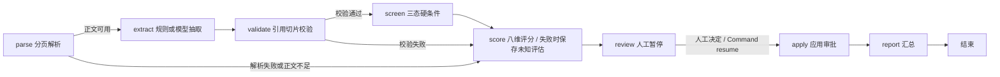
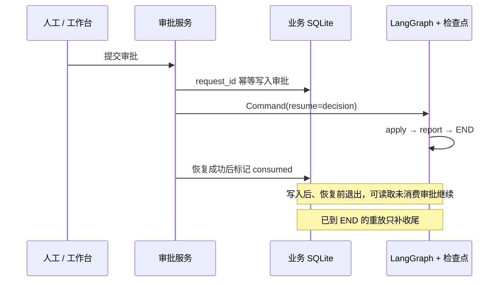

# 架构与模型边界

核对日期：2026-10-29。本文描述当前源码；项目以企业面试场景的工程作品集收尾，不将未实现能力画成现状。

## 系统组成

| 层 | 实现 | 职责 |
| --- | --- | --- |
| 工作台 | React 18 / TypeScript / Vite | 批次、证据复核、审批、模拟排期、聚合看板与处理记录 |
| 服务入口 | `app/api.py` | FastAPI REST；后台线程处理批次，SSE 推送任务进度 |
| 其他入口 | `main.py`、`mcp_server.py` | CLI 直接复用业务模块；MCP 通过 HTTP 代理工作台 API |
| 候选人分析 | `src/workflow.py` | LangGraph 条件路由、人工暂停、检查点恢复 |
| 抽取与规则 | `providers/model_extractor.py`、`evidence.py`、`scorer.py` | 模型/规则抽取、引用定位、证据校验、确定性评分 |
| 数据 | `repository.py`、`task_store.py` | 业务 SQLite、分页文本缓存、批次任务快照 |
| 检查点与记录 | SqliteSaver、`observability.py` | 独立检查点 SQLite；批次处理摘要写 JSONL |
| 模拟外部动作 | `scheduler.py`、`providers/mock_*` | 独立批次排期、模拟建会与通知、失败动作重试 |

默认是单用户本地实例。图执行由进程内锁串行化；任务状态持久化不代表具备分布式任务调度能力。

## 候选人工作流

1. **parse**：PDF 文本解析、图片 OCR、DOCX 文本解析。文件名只作展示元数据，不参与评分。原文件按内容哈希保存，已缓存页面仅在同内容文档内复用。
2. **extract**：规则抽取器或云端模型生成事实、任职区间和引用；模型返回页码与引文，由程序定位字符偏移。
3. **validate**：检查页码、范围及 `quote == Page.text[start:end]`。校验原文位置，不等同于证明语义判断正确。
4. **screen / score**：程序判断硬条件的 pass / fail / unknown；按固定岗位规则给八维评分。解析或引用校验失败时，只保存未知评估并进入人工复核，公开得分为 null，不将失败简历显示为 0 分。缺失项保持 unknown，`known_score` 仅累计已确认项。
5. **review**：所有正常分析路径最终都会在此暂停，包括机器建议 recommend / hold 的结果。机器建议不等同于人工审批。
6. **apply / report**：恢复后应用审批并生成报告，不在候选人图中自动建会或发送通知。

硬条件为：相关领域经验 AND（总工作经验 ≥ 8 年 OR 直接相关经验 ≥ 5 年）AND 项目或团队管理经历。
评分完整、硬条件通过时，75 分及以上建议 recommend，60–74 分建议 needs_review，低于 60 分建议 hold；未知硬条件或不完整评分建议 needs_review，硬条件明确失败建议 hold。

## 模型推理的职责范围

| 环节 | 模型可以产出什么 | 程序或人工负责什么 |
| --- | --- | --- |
| 阅读正文 | 岗位事实、预设档位、任职区间、页码与引文 | 文件解析、文件名隔离、页面存储 |
| 引用 | 指出原文片段 | 计算偏移、检查页码和切片一致性 |
| 档位 | 选择结构化枚举，报告不确定信息 | 领域词表辅助检查；最终语义核对仍由人工完成 |
| 年限 | 抽取任职起止时间 | 引用年份检查、区间合并、阈值判断 |
| 筛选与评分 | 不直接决定总分或最终批准 | 固定规则计算分数和机器建议；人工批准 |
| 外部动作 | 不自主选择工具执行招聘流程 | 独立排期器及 mock provider 执行动作 |

这是受约束的模型抽取与有状态工作流，不含多 Agent 讨论、开放式自主规划或循环工具决策。展示结构化输入输出、引用和运行统计即可说明模型行为；系统没有实现模型内部思维链的获取或验证。

模型客户端通过 OpenAI 兼容的 `/chat/completions` 接口发送分页正文，以 Pydantic 解析 JSON 输出，并处理有限重试及一次格式纠正。未启用或配置缺失时返回空报告与提示；定位失败的条目跳过，部分一致性检查失败的事实降级 unknown。警告本身不一定直接改变路由，最终仍由证据检查及规则评分处理剩余事实。调用后估算费用并提示超预算，不能将该配置理解为调用前的硬性费用熔断。规则抽取模式不调用云端模型；OCR 使用本地工具。

## 审批恢复与排期

审批请求必须带已查看的 assessment_id、expected_version 和稳定 request_id，前端与 MCP 均使用这一契约。每次执行保存独立、不可覆盖的评估 ID；旧页面不能批准新评估，重用幂等键改变决定会冲突。重复同一决定只恢复已有审批；批次关闭后不接受新决定。审批和排期在本地进程内串行协调，数据库唯一约束负责持久防重。

排期是独立入口：建轮 → 冻结 → 查询已批准候选人 → 按总分、钢结构/MiC、海外、管理维度排序 → 原子占槽 → 模拟建会 → 模拟通知。默认四个 45 分钟时段，无可用时段则候补。CLI 可演示失败动作重试；会议与通知均为 mock，不代表接入了真实企业系统。

## 收尾修复与当前实现限制

2026-10-29 收尾已修复：

- **同一次证据快照**：原文件、分页文本、事实、引用偏移和评分持久保存；GET 复核只读取，不再调用模型。评分匹配事实 ID，未知维度不画成 0 分。
- **内容与评估身份**：同路径不同内容使用新文档；同名上传不覆盖旧文件；新批次保存新评估和独立审批，历史评估可只读查看。
- **严格审批与恢复**：客户端绑定已查看的评估；幂等键固定一次决定；恢复失败明确返回已保存、待恢复。独立 Python 进程恢复有自动测试。
- **动作防重**：重复排期返回原预约；成功动作不再调用 provider；会议失败不发通知；通知失败沿用原会议。没有已批准候选人时不会意外关闭审批。
- **失败可见**：解析失败保存未知评估，批次异常标记 failed，服务启动把遗留 running 标记 interrupted。已完成项保留，重新分析由人工发起。
- **维护一致性**：CLI 支持 needs_review，MCP 传递审批身份并支持配置式 Cookie 登录；检查点显式允许项目 schema 类型；当前任职截止日默认取启动日期，可通过 ANALYSIS_DATE 固定。

保留的边界：

| 边界 | 当前行为 |
| --- | --- |
| 历史数据 | 旧评估无快照时不会自动补抽取；页面明确说明，审批返回冲突，需重新分析。旧历史审批不被改写为新评估审批。 |
| 本地任务 | 单进程本地工作台，后台线程不具备自动续跑或分布式队列能力；重启后显示中断状态并交回人工。 |
| 模型结果 | 引用位置合法不等于语义判断正确；领域词表与年份检查仅缓解部分风险，所有候选人仍等待人工决定。 |
| 信息保护 | Fernet 只覆盖 documents.pii_* 三列；原文件副本、页面和完整评估快照仍含明文。保留期由 CLI 执行，任务快照、trace 等不是完整级联清理范围。 |
| 外部动作 | 会议、通知均为 mock；验证的是本地幂等键与状态机制，不代表真实企业系统已经接入或取得效果。 |
| 可观测范围 | 批次摘要与审批事件可查；没有完整分布式追踪，也不展示模型内部思维过程。 |
| 部署 | 认证默认关闭，org_id 只预留列；没有多租户隔离。Docker 配置尚未构建实测。 |

[收尾验收](acceptance.md) 将三个展示成果与自动测试、现有离线演示和真实页面检查对应。项目在这一范围完结，不把保留边界继续扩成平台功能。
